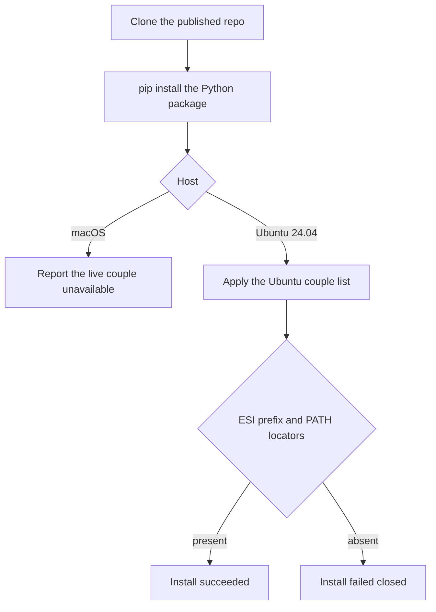

# Linux VM couple deploy - Plan

**Target repo:** engineering-tools. Paths below are relative to that repo.

## Goal Capsule

- Objective: a published clone can install the current Python package and, on Ubuntu 24.04, the Linux couple the live session already checks for.
- Authority: this plan, then `STRATEGY.md` where it prefers distro or upstream packages over a frozen image.
- Execution profile: code plus the operator document. Local tests prove recipe selection. A VM smoke proves the binaries exist. A coupled solve is out of this plan.
- Stop conditions: do not retarget the existing hello recipes, do not add npm, do not install the commercial catalog, and do not treat a Mac PATH install as a live couple.
- Tail ownership: follow this plan's landing notes. Repo conventions and the user's request override them.

## Product Contract

### Summary

A fresh clone of the GitHub project installs the current stack from one requirements list and the existing Python installer. The Ubuntu VM gets the couple needed to continue. OpenFOAM ESI 2512, preCICE 3, the CalculiX bridge, gmsh, and MPI. A Mac install stops at the Python package and reports the live couple unavailable. Solver physics stays as it is.

### Problem Frame

The live session is engineering only when `rhoPimpleFoam` is the ESI 2512 linux64 binary and preCICE, `ccx_preCICE`, gmsh, and `gmshToFoam` are findable, with `mpirun` used to start the solid. This Mac cannot provide that prefix. The installer that exists today apt-installs distro `openfoam` and `calculix-ccx`. The project README already says that distro OpenFOAM and a bare `ccx_preCICE` without `mpirun` do not complete the couple. There is no JavaScript package, so npm is the wrong installer.

### Requirements

**Package install**

- R1. A fresh clone installs the Python package from `pyproject.toml` with pip, including the dev extra used by the test suite.
- R2. Ubuntu 24.04 installs the live couple from one requirements list. The list uses apt for archive packages and pinned upstream debs where Ubuntu has no current package.

**Couple versus hello**

- R3. The couple list provides ESI OpenFOAM 2512 at its packaged prefix, a preCICE 3 library package, the CalculiX adapter package that provides `ccx_preCICE`, gmsh, and an MPI runtime that provides `mpirun`.
- R4. The couple list does not select distro `openfoam` or plain `ccx` as the live participant.
- R5. The existing CalculiX and OpenFOAM hello recipes stay the distro packages they are today.

**Hosts**

- R6. On macOS the installer installs the Python package and reports the live couple unavailable. It does not run apt.
- R7. The documented clone is `https://github.com/mhold3n/engineering-tools`. The steps match the published default branch.

### Scope Boundaries

- Deferred to follow-up work: the two-point engineering campaign, a container image, and the full product-catalog waves.
- Outside this product's identity: an npm wrapper, a Mac build of the ESI linux64 prefix, and rewriting solver physics.

### Dependencies

The published default branch must contain this deploy work before a clean clone matches the document. Publishing that branch is a prerequisite the implementer does not invent a second remote for.

### Sources

- `README.md` names ESI openfoam2512, libprecice3, and `mpirun -n 1`, and rejects distro OpenFOAM 1912 for the couple.
- `src/engineering_tools/data/stack.json` hello recipes are apt packages `calculix-ccx` and `openfoam`.
- `src/engineering_tools/install.py` already supports apt, pip, and archive recipes, and refuses an install destination inside the git worktree.
- ESI packages install with the OpenFOAM Debian repo script and `openfoam2512-default`, which lands under `/usr/lib/openfoam/openfoam2512/`. Official notes: [Debian and Ubuntu packages](https://gitlab.com/openfoam/core/openfoam/-/wikis/precompiled/debian). Ubuntu 24.04 and 22.04 are the supported LTS targets. Ubuntu 25.10 has had a package-index mismatch.
- preCICE publishes Ubuntu debs, not a distro apt package that tracks current releases. Current noble package cited by the project is `libprecice3_3.5.0_noble.deb`. [System packages](https://precice.org/docs/installation/packages/).
- The CalculiX adapter deb `calculix-precice3` 2.20.2 is the noble package that depends on preCICE 3. The 2.20.1 noble package wrongly depends on `libprecice2`. [Get the CalculiX adapter](https://precice.org/docs/adapters/calculix/get-adapter/).

## Planning Contract

### Key Technical Decisions

- KTD1. Distribution is pip for the MIT package and apt plus pinned debs for the couple. npm is not added.
- KTD2. The couple is a new profile beside the hello recipes. Changing `calculix` or `openfoam` in `stack.json` would make the hello probes look for `ccx_preCICE` and `rhoPimpleFoam`, which those probes do not run.
- KTD3. The installer aims the ESI package at the prefix the session already treats as authoritative. It does not add a macOS substitute path.
- KTD4. Success of the install is the expected binaries being present. `e_ok` from a coupled solve stays a later campaign.
- KTD5. A container image is deferred. `STRATEGY.md` allows containers later. The current session reads host binaries, so the VM installs those binaries on the host.

### High-Level Technical Design

### Assumptions

- The VM is Ubuntu 24.04 on amd64. Other Ubuntu releases need their own deb names and are out of this plan.
- `gmsh` and `openmpi-bin` come from the Ubuntu archive. Implementation confirms the locator names before freezing the list.
- The preCICE deb's tool name is confirmed from the package contents. If `precice-tools` is absent, the list gains the package that provides the locator the session already searches. That search order is `precice-tools`, then `binprecice`, then `precice`.
- `ETOOLS_E_MOCK_SOLVERS` stays unset on the VM. A set value forces the session down the mock path.

### Sequencing

U1 freezes the list. U2 applies it. U3 documents the clone. U4 locks the selection tests. U3 can be drafted with U1. U4 waits on U1.

## Implementation Units

### U1. Couple requirements list

- Goal: one machine-readable list of the Ubuntu 24.04 couple, separate from the hello component recipes.
- Requirements: R2, R3, R4, R5.
- Dependencies: none.
- Files: `src/engineering_tools/data/stack.json` is read and not retargeted. Add the list beside the existing install data, and cover it from `tests/test_install_waves.py` or a new test module next to it.
- Approach: record archive packages and pinned deb URLs, including the ESI repo setup, `openfoam2512-default`, the noble preCICE 3 deb, and calculix-precice3 2.20.2. Keep hello `calculix` and `openfoam` recipes unchanged.
- Execution note: characterize the current hello recipe packages before adding the couple list, so the new list cannot silently replace them.
- Patterns to follow: `src/engineering_tools/install_waves.py` wave ids, and the apt recipe shape in `stack.json`.
- Test scenarios:
  - Happy path: the couple list names ESI OpenFOAM 2512, a preCICE 3 deb, the 2.20.2 CalculiX adapter deb, gmsh, and an MPI package.
  - Edge: the 2.20.1 adapter deb is not the pinned package.
  - Error: a list entry with an empty package or URL is rejected.
  - Integration: the hello `calculix` package remains `calculix-ccx` and the hello `openfoam` package remains `openfoam`.
- Verification: the new test fails if the couple list selects the hello packages, and the existing wave tests still pass.

### U2. Apply the couple list on Ubuntu only

- Goal: one install entry applies the couple list on Ubuntu and reports it unavailable elsewhere.
- Requirements: R1, R2, R6.
- Dependencies: U1.
- Files: `src/engineering_tools/install.py`, the CLI install surface in `src/engineering_tools/cli.py`, `tests/test_install_waves.py`.
- Approach: reuse apt and archive execution. Put downloaded debs and receipts outside the git worktree, which `install.py` already requires. On macOS, skip apt and return a clear unavailable result. Do not set the mock-solver environment variable. After Ubuntu install, the success check is the ESI `rhoPimpleFoam` file, `gmshToFoam` from that prefix, `ccx_preCICE`, a preCICE locator, `gmsh`, and `mpirun`.
- Execution note: prove the host branch with a test before wiring apt execution. The apt execution itself is the VM smoke, not a laptop test.
- Patterns to follow: `assert_outside_worktree` and the existing apt recipe result shape.
- Test scenarios:
  - Happy path: a non-Ubuntu host does not attempt apt and reports the couple unavailable.
  - Edge: an install destination inside the repo is refused.
  - Error: a missing locator after the Ubuntu apply is a failed install, not a success with a warning.
  - Integration: the Python package install remains `pip install -e ".[dev]"` and is not folded into the apt transaction.
- Verification: host-branch tests pass on this Mac. The binary check is specified so the VM smoke can use the same locators.

### U3. Clone and install document

- Goal: a new clone can follow one document from GitHub to a ready Ubuntu VM or a Mac package install.
- Requirements: R1, R6, R7.
- Dependencies: U1, U2.
- Files: `README.md`.
- Approach: state the clone URL, the pip install, the couple command, the Ubuntu 24.04 assumption, and the Mac outcome. State that install success is the locators, and that a coupled solve is a later run. Do not document npm.
- Test expectation: none. This unit is the operator document. U4 covers the list the document names.
- Verification: a reader can name the clone URL, the pip command, the couple command, and which host gets the live binaries without reading the installer source.

### U4. Selection tests stay green

- Goal: hello recipes and the couple list cannot drift into each other.
- Requirements: R4, R5.
- Dependencies: U1.
- Files: `tests/test_install_waves.py` and the couple list test from U1.
- Approach: extend the existing wave tests only where they already lock recipe identity. Do not start solvers.
- Execution note: these are characterization tests around the current hello packages plus the new list.
- Test scenarios:
  - Happy path: wave `2-cae-core` still contains `calculix` and `openfoam`.
  - Edge: the couple list is not a member of that wave.
  - Error: an unknown wave name still fails the way it does today.
- Verification: `tests/test_install_waves.py` passes with the new assertions.

## Verification Contract

| Gate | Where | Done when |
| --- | --- | --- |
| Hello recipes unchanged | `tests/test_install_waves.py` | Existing wave assertions pass and still expect distro `calculix-ccx` and `openfoam` |
| Couple list | the new couple-list test | ESI 2512, preCICE 3, adapter 2.20.2, gmsh, and MPI are selected, and the hello packages are not |
| Host branch | the install host test | macOS reports the couple unavailable and does not call apt |
| VM smoke | Ubuntu 24.04, after publish | The ESI `rhoPimpleFoam` file, `gmshToFoam`, `ccx_preCICE`, a preCICE locator, `gmsh`, and `mpirun` are present. A solve is not required |

## Definition of Done

- U1 through U4 meet their verification lines.
- The README clone path and the requirements list name the same packages.
- Hello `stack.json` recipes for `calculix` and `openfoam` are unchanged.
- Abandoned install experiments are not left in the tree.
- The VM smoke is recorded as not run until the published branch is on an Ubuntu 24.04 host. That open smoke does not block the local tests.

## Risks and dependencies

- The 2.20.1 CalculiX adapter deb fails on Ubuntu 24.04 because it depends on `libprecice2`. The pin is 2.20.2.
- ESI package indexes have broken on non-LTS Ubuntu. The target stays 24.04.
- A clone of today's default branch does not contain this branch's uncommitted couple work. The document is wrong until that work is what GitHub serves.
- Upstream deb URLs move. The list pins versions and the implementation fails closed when a download or locator is missing.
- The ESI repo bootstrap is a root shell from `dl.openfoam.com`. The implementer records the key and the apt source it adds, and fails closed if that script is not the current documented bootstrap. Do not pipe an unseen script into a shell from the test suite.

## Plugin and capability use

### Planning

- ce-plan, because the user asked for this plan. No other plugin. Local repo reads plus the OpenFOAM and preCICE package docs were enough.

### Execution

- No plugin. The implementer uses the repo's pytest entry and the existing apt and pip installers.

### Validation

- `tests/test_install_waves.py` and the new couple-list and host-branch tests. The Ubuntu smoke is a host check of the locators, not a pytest run on macOS.
